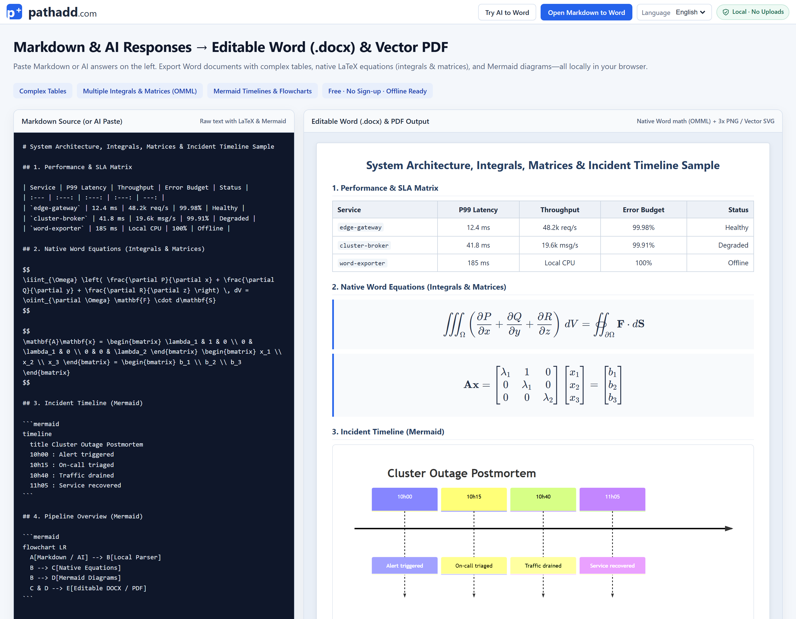

# Pathadd ? Markdown to Word (Chrome Extension)

Convert Markdown and AI responses (ChatGPT, Claude, etc.) with **native editable Word equations (OMML)**, matrices, tables, and **Mermaid diagrams** into real `.docx` files directly in your browser.

Everything runs **100% locally**?zero server uploads, no account required, Manifest V3, and minimal permissions.

## Install

- **Chrome Web Store**: [Pathadd ? Markdown to Word](https://chromewebstore.google.com/detail/pathadd-%E2%80%94-markdown-to-wor/gllomoipeokhaggeeocbnncojigfmbip)
- **Web Version**: [pathadd.com/en/tools/markdown2word/](https://pathadd.com/en/tools/markdown2word/)

## Key Features

- **Native Word Equations (OMML)**: Converts LaTeX (`$...$`, `$$...$$`, matrices, integrals, aligned blocks) into editable Microsoft Word / WPS equations?not blurry screenshots.
- **Mermaid Diagrams**: Renders flowcharts, sequence diagrams, and timelines cleanly into embedded high-DPI PNGs inside `.docx`.
- **Clean Tables & Code Blocks**: Preserves OpenXML table grids, borders, and syntax formatting.
- **Local-First & Private**: Zero remote scripts, zero telemetry, all parsing and `.docx` packaging happen client-side.

## Load Unpacked Locally (Developer Mode)

1. Clone or download this repository.
2. Open `chrome://extensions/` in Chrome or Edge.
3. Enable **Developer mode** (top right).
4. Click **Load unpacked** and select this repository root (the folder containing `manifest.json`).

## Related Writing

- [Why Converting Markdown + LaTeX + Mermaid Into Real Word Docs Is Harder Than It Looks](https://dev.to/pathadd/why-converting-markdown-latex-mermaid-into-real-word-docs-is-harder-than-it-looks-5eip)
- [How a 24-Hour Apache Pulsar Outage Turned Into a Local-First Web Toolkit](https://dev.to/pathadd/how-a-24-hour-apache-pulsar-outage-turned-into-a-local-first-web-toolkit-2j82)
